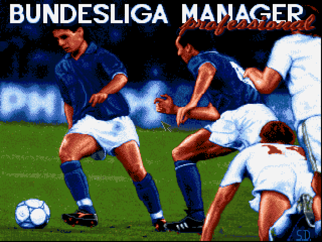
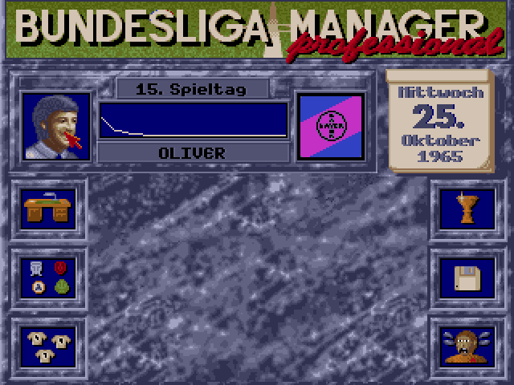
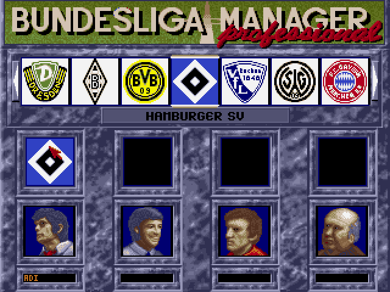
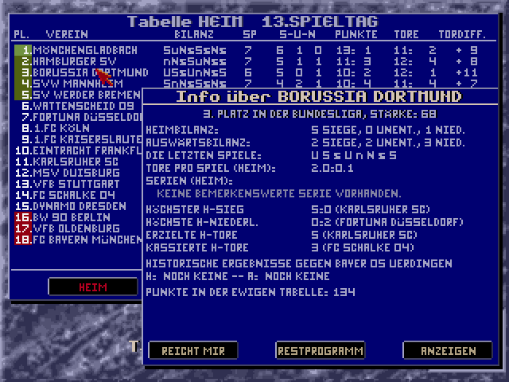
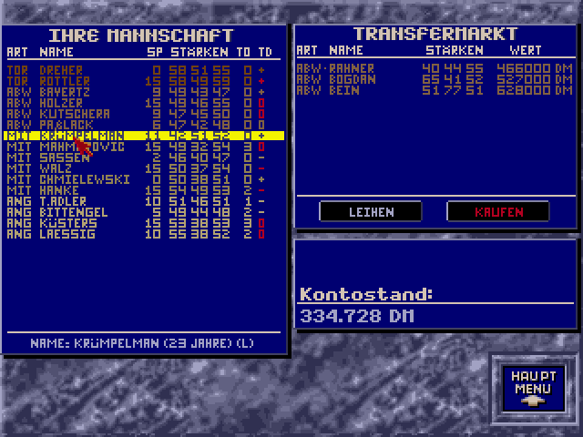
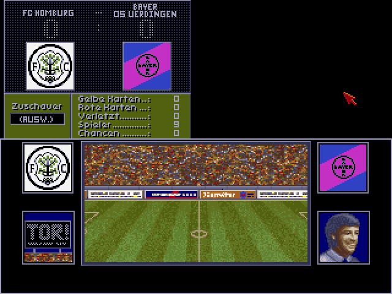
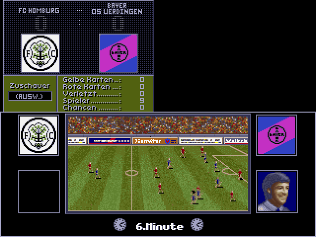
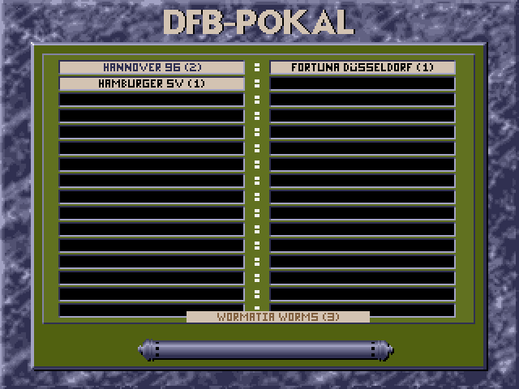

# Bundesliga Manager Professional (Rust Port)

> **Disclaimer.** This project is not affiliated with Software 2000, the DFL, the DFB or
> any football club. No original game data is included; you need your own copy of the game.

A faithful port of the DOS classic **Bundesliga Manager Professional** (Software 2000, first
released in 1991) to Linux, written in Rust. The port follows version 2.0 of the game (1992),
which offers the 1992/93 season as a second start. It is not a remake "inspired by" the original: every screen, every rule
and every random draw was reconstructed from the original executables with Ghidra, and it is
checked frame by frame against the DOS game running in DOSBox.

<p align="center">
  
  
</p>

> **No original game data is included.** You need your own copy of the DOS game. The port
> reads its pictures, sounds, club database and save games at runtime.

## The game

Bundesliga Manager Professional puts you in charge of a German football club. You pick a club,
type in your name and run the club for one, three or an endless number of seasons, starting
either in the historic 1963/64 season or in 1992/93. Up to four managers can play at the same
table in hot-seat mode.

As a manager you are responsible for everything:

- **The team:** set the line-up and tactics on the tactics board, decide on training and book
  training camps, watch fitness, injuries and suspensions.
- **Transfers and contracts:** buy, sell and loan players on the transfer market, answer offers
  from other clubs, and negotiate contract length and salary with your players.
- **Finances:** ticket prices, sponsors and advertising boards, TV money, loans with interest,
  and the expansion of your stadium, stand by stand.
- **Competitions:** Bundesliga, 2. Bundesliga and Oberliga with promotion, relegation and the
  relegation play-off, the DFB-Pokal and the three European cups, each with its own draw.
- **Match days:** follow your match live with a minute ticker, chances, cards and injuries,
  watch animated goal scenes, read the newspaper report the next morning and see how the other
  results changed the table.

The computer clubs play by the same rules: they shift in strength over the weeks, react to
results and compete with you for players and titles. The game keeps statistics, an eternal
table, the history of each manager and a high-score table.

## Screenshots

All screenshots are rendered by the port.

| | |
|---|---|
|  |  |
| *Start menu: choose your club and enter your name* | *League tables with club information* |
|  |  |
| *Squad and transfer market* | *Live match view with goal panel* |
|  |  |
| *Animated goal scene* | *DFB-Pokal draw* |

## How faithful is it?

| Area | Status |
|---|---|
| Game flow | Logo intro → title with music → start menu → new game or saved game → office → season → season end → game end |
| Office | All six areas: info (statistics, eternal table, history, stadium, loans, advertising), tables, team (line-up, contracts, transfer market, training, training camp, top scorers), cups, disk/options, quit |
| Match day | Live view, goal and miss scenes, half-time and full-time results, tables, newspaper, cup draws, title ceremonies, substitutions |
| Game logic | Complete: finances, computer clubs, match simulation, leagues, cups, squad, transfers, new game, newspaper, season loop |
| Random numbers | Bit-exact: the same seed gives the same season as the DOS game |
| Team editor | `TEAMED.EXE` with all its screens; the `MANA.DAT` and crest files it writes are byte-identical to the original's |
| Graphics | About 370 reference frames of the game and the editor; all but 20 match the original pixel for pixel, the rest differ only in the mouse pointer position or a documented bug fix (99.7 % or better) |
| Sound | Title music on an OPL2 (YM3812) emulation; the register stream equals the original driver's write for write; digitised crowd, whistle and goal sounds |
| Save games | Read and written byte for byte compatible with the DOS version, in both directions |

Version 1.0.0 marks the 1:1 port as complete. Obvious bugs of the original were fixed and are
marked as deviations in the specifications; everything else behaves like the DOS version.
Known gaps are tracked in the [issues](../../issues).

The game was also sold in English as *The Manager*, with the English leagues. The engine still
contains the switches for that edition (English ordinal suffixes and number format). An English
version of the port is planned once the German port is complete.

## Installation and running

The port is built and tested on Linux (x86-64). Other systems are untested.

### Requirements

- **A C toolchain, git, curl and the SDL2 development libraries.** One command per
  distribution:

  | Distribution | Command |
  |---|---|
  | Debian, Ubuntu, Linux Mint | `sudo apt install build-essential curl git libsdl2-dev` |
  | Fedora | `sudo dnf install gcc curl git SDL2-devel` |
  | Arch Linux | `sudo pacman -S --needed base-devel curl git sdl2` |

  `pkg-config` is not needed: the program links against the system's `libSDL2` directly.
- **Rust 1.88 or newer.** The code uses edition 2024 (Rust 1.85) and language and library
  features stabilised in Rust 1.88. Install Rust with [rustup](https://rustup.rs) and load its
  environment into the current shell:

  ```sh
  curl --proto '=https' --tlsv1.2 -sSf https://sh.rustup.rs | sh
  . "$HOME/.cargo/env"
  ```

  An existing installation is brought up to date with `rustup update`; `rustc --version`
  shows the version.
- **Your own copy of the DOS game** (see [The original game data](#the-original-game-data)).

### Getting the source

```sh
git clone https://github.com/milchgeldkassierer/bundesliga-manager-rs.git
cd bundesliga-manager-rs
```

The repository has two branches:

| Branch | Content |
|---|---|
| `main` | The 1:1 port, version 1.0.0 (the default) |
| `mod_2026` | Mod 2026: the same game with the clubs, squads and leagues of 2026 |

For Mod 2026, switch to its branch with `git checkout mod_2026` before building; its README
describes how to generate the mod data.

### Building

```sh
cargo build --release -p bmp
```

The first build downloads the dependencies from crates.io and takes a few minutes. The
program ends up as `target/release/bmp`; it is self-contained apart from SDL2 and can be copied
anywhere. `./target/release/bmp --help` lists every command and option.

### The original game data

The port expects the data of **version 2.0 (1992)** of Bundesliga Manager Professional,
the version with the 1992/93 season as a second start, from your own copy of the game. The
data directory is the game's installation directory and must contain:

| File or folder | Content |
|---|---|
| `BMINTRO.EXE` | The logo intro (its animation and palette are read from it) |
| `BMMAIN.EXE` | The game (its fonts and palettes are read from it) |
| `MANA.DAT` | The club database |
| `PIC/` | Pictures (`*.VGA`, `*.CP`, `1.PAL`) |
| `SOUND/` | `BM2TITLE.CMF` (title music) and `DIGI.VOC` (crowd, whistle, goal) |
| `TORE/` | The goal scenes |

`TEAMED.EXE`, `BMLOADER.EXE`, `BMP.BAT`, the high-score files `HIGH.*` and the save games
`*.MAN` may be there too; the port never runs the DOS programs.

**File names are case-sensitive on Linux.** The port looks for the upper-case names of the
DOS game (`BMMAIN.EXE`, `PIC/47.CP`). Only save games and high-score files are found in any
case. If your copy came with lower-case names (`bmmain.exe`, `pic/`), rename everything to
upper case once, inside the data directory:

```sh
find . -depth -mindepth 1 -execdir sh -c 'n=$(printf %s "$1" | tr a-z A-Z); [ "$1" = "$n" ] || mv "$1" "$n"' _ {} \;
```

**Work on a copy.** The game writes its save games and high scores into the data directory,
and the team editor rewrites `MANA.DAT` and the crest pictures in `PIC/`. Copy the game to a
directory of its own (files from a CD or another read-only source also need to be made
writable):

```sh
cp -r /path/to/your/BMP ~/games/BMP
chmod -R u+w ~/games/BMP
```

### Running

```sh
./target/release/bmp --data ~/games/BMP run
```

`--data` points to the data directory. Alternatively set the environment variable `BMP_DATA`
once and leave `--data` out:

```sh
export BMP_DATA=~/games/BMP
./target/release/bmp run
```

The game starts like `BMP.BAT` in DOS: the Software 2000 logo intro, then the title screen with
the music, then the start menu, where you pick a club, enter your name and choose the start
season, or load a saved game. The window shows the game's 320x240 screen at three times its
size.

| Option | Effect |
|---|---|
| `run 0` or `run --nosound` | No sound, like `BMP.BAT 0` in the original |
| `run --skip-intro` | Start directly at the title screen |
| `show-pic <name>` | Show a single picture, e.g. `47.CP` |
| `render-music <out.wav>` | Render the title music to a WAV file |

The game is played with the mouse like the original: left click selects, right click confirms
or leaves a screen. Names are typed on the keyboard. Any key skips the intro. Closing the
window ends the program.

**Save games** are written into the data directory (or a subdirectory picked in the game's file
dialog) as `<NAME>.MAN`, in the DOS game's format: saves of the DOS version load in the port and
the other way round. At every month end the game also writes `AUTOSAVE.MAN`; the high scores
are kept in the `HIGH.*` files.

### Team editor

The team editor `TEAMED.EXE` is ported too:

```sh
./target/release/bmp --data ~/games/BMP teamed
```

It edits `MANA.DAT` in the data directory like the original. You can change club names,
league placement, last season's table (rank, points, goals), player names, the club crests
(paint them or import an IFF/ILBM picture) and the names and strengths of the foreign UEFA
clubs. "PROGRAMM-ENDE" followed by "MACH MAL !" saves, and the next `bmp run` uses the edited
data. The editor writes into the data directory, so keep a backup of `MANA.DAT` and `PIC/`.

### Troubleshooting

| Message or symptom | Cause and remedy |
|---|---|
| `rust-lld: error: unable to find library -lSDL2` (or `cannot find -lSDL2`) when building | The SDL2 development libraries are missing: install them with the command for your distribution under [Requirements](#requirements). |
| ``error[E0658]: `let` expressions in this position are unstable`` or ``use of unstable library feature `slice_as_chunks` `` when building | Rust is older than 1.88: run `rustup update`. |
| ``error: linker `cc` not found`` when building | No C toolchain: install `build-essential`, `gcc` or `base-devel` (see [Requirements](#requirements)). |
| `no game data directory: pass --data <dir> or set BMP_DATA` | Neither `--data` nor `BMP_DATA` was given. |
| `FONT-Error: I/O error: No such file or directory (os error 2)` | The data directory has no `BMMAIN.EXE`: `--data` points to the wrong directory, or the file names are lower case (see [The original game data](#the-original-game-data)). |
| `.../MANA.DAT: No such file or directory (os error 2)` when a game starts | `MANA.DAT` is missing or lower case. |
| The game shows `DISK-Error` and quits | A picture, sound or goal scene is missing: check `PIC/`, `SOUND/` and `TORE/`. The game writes the running game to `ERROR.MAN` first. |
| `no audio output (...); sound runs silently` | SDL found no audio device; the game runs without sound. Check the system's sound output (PulseAudio or PipeWire), or start with `run --nosound`. |
| `GRAFIK-Error: No available video device` | SDL could not open a window: start the game from a graphical session. |

## How it was made

1. **Reverse engineering.** The original executables (`BMINTRO.EXE`, `BMMAIN.EXE`, unpacked from
   EXEPACK) were analysed in Ghidra. Every subsystem has a written specification in
   [`docs/re/logic/`](docs/re/logic) with pseudo-code, data tables and the order of the random
   draws; file formats are documented in [`docs/re/`](docs/re).
2. **Faithful port.** The Rust code follows the specifications function by function. Every
   ported function names its origin (`Origin: BMMAIN.EXE seg:off`), including the original's
   bugs and quirks where they change what the player sees.
3. **Verification.** `tools/visual-check.sh` replays scripted mouse and keyboard input on the port
   (headless, on a virtual clock) and on the original in DOSBox, and compares every screenshot
   pixel by pixel (`bmp compare`, tolerance in [`docs/re/TOLERANCES.md`](docs/re/TOLERANCES.md)).
   Random content is compared by recovering the original run's random seed. Logic is covered by
   more than 550 unit tests, many of them against the shipped save games.

## Project layout

| Path | Content |
|---|---|
| `crates/bmp-formats` | Parsers for `.VGA`, `.CP`, `.PAL`, `TORE/*`, `MANA.DAT`, `*.MAN`, `.CMF`, `.VOC`, fonts, EXEPACK |
| `crates/bmp-game` | The game logic reconstructed from `BMMAIN.EXE` |
| `crates/bmp-sound` | OPL2 emulation, the Creative FM driver, music and voice playback |
| `crates/bmp` | The executable: VGA/mouse library, host (SDL2 or scripted headless), all screens |
| `docs/re/` | Reverse-engineering notes, function and memory maps, subsystem specifications |
| `tests/visual/` | Scripted scenarios for the visual comparison with the original |
| `tools/` | `check.sh` (fmt, clippy, tests), `visual-check.sh`, DOSBox capture and Ghidra helpers |

## Legal

This repository contains no code, sounds or data files of the original game; the port loads
them from your own copy at runtime. The screenshots in `docs/screenshots/` show the original
artwork as rendered by the port. Bundesliga Manager Professional is © 1991–1992 Software 2000; all
trademarks belong to their owners. The port's own code is released under the
[MIT licence](LICENSE).
